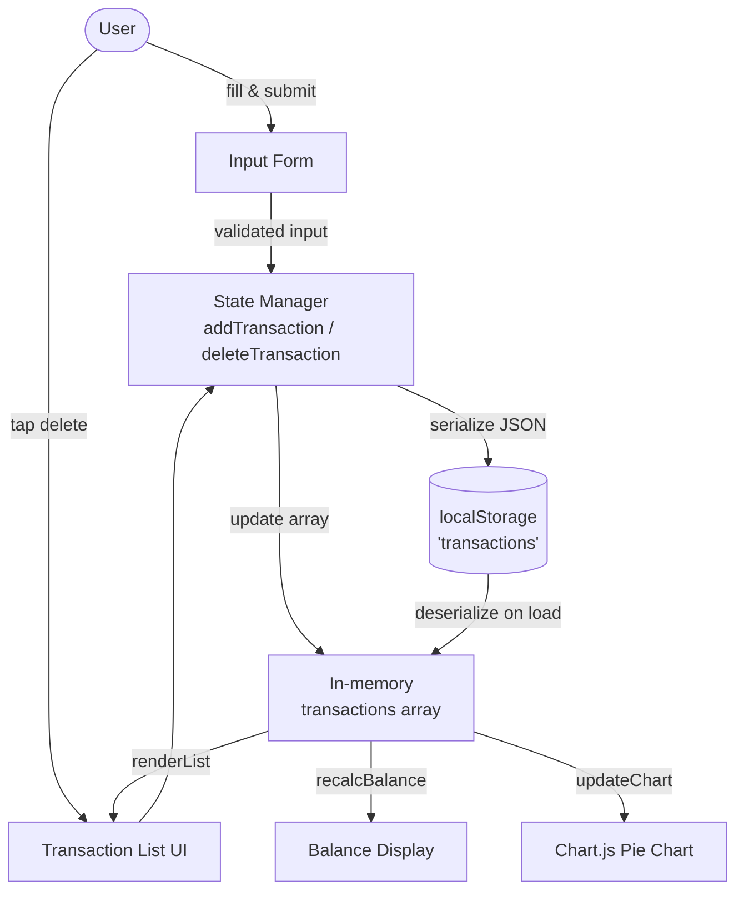

# Design Document

## Overview

The Expense & Budget Visualizer is a single-page, client-side web application delivered as a single `index.html` file with an accompanying `style.css` and `app.js`. It runs entirely in the browser with no server-side component. All state is held in memory as a plain JavaScript array and persisted to `localStorage` under the key `"transactions"`. Chart.js (loaded from CDN) renders a live pie chart of spending by category.

The application follows a simple event-driven architecture: every user action (add transaction, delete transaction) triggers a central state update function that (1) writes to `localStorage`, (2) re-renders the transaction list, (3) recalculates and updates the balance display, and (4) mutates and refreshes the Chart.js instance.

**Key design decisions:**

- **No build step** — plain HTML/CSS/JS so the app opens directly in a browser.
- **Single source of truth** — the in-memory `transactions` array is always authoritative; the DOM and `localStorage` are projections of it.
- **Mutation over recreation** — the Chart.js instance is created once and updated via `chart.data` mutation + `chart.update()` to avoid the "canvas already in use" error.
- **Graceful degradation** — `localStorage` failures surface a visible banner rather than silently losing data.

---

## Architecture



**Module responsibilities:**

| Module | File | Responsibility |
|--------|------|----------------|
| Markup & layout | `index.html` | DOM structure, viewport meta, Chart.js CDN `<script>` |
| Styles | `style.css` | Responsive grid, typography, touch targets |
| State Manager | `app.js` | Load, add, delete, persist transactions |
| Validator | `app.js` | Validate form fields, show/clear inline errors |
| Renderer | `app.js` | Re-render list, balance, chart on every state change |
| Storage Adapter | `app.js` | Wrap `localStorage` calls; catch exceptions |

All modules live in `app.js` as named functions to keep the project self-contained without a bundler.

---

## Components and Interfaces

### 1. Input Form Component

**DOM structure:**
```html
<form id="expense-form">
  <input id="item-name"   type="text"   maxlength="100" />
  <span  id="err-name"    class="error-msg" aria-live="polite"></span>

  <input id="item-amount" type="number" min="0.01" max="999999999.99" step="0.01" />
  <span  id="err-amount"  class="error-msg" aria-live="polite"></span>

  <select id="item-category">
    <option value="">-- Select category --</option>
    <option value="Food">Food</option>
    <option value="Transport">Transport</option>
    <option value="Fun">Fun</option>
  </select>
  <span  id="err-category" class="error-msg" aria-live="polite"></span>

  <button type="submit">Add Transaction</button>
</form>
```

**JavaScript interface:**
```js
// Reads form fields, returns a validated Transaction or null
function validateForm(): { transaction: Transaction } | { errors: FieldErrors }

// Resets all fields to empty/default after successful submission
function resetForm(): void
```

### 2. Transaction List Component

**DOM structure:**
```html
<ul id="transaction-list" aria-label="Transaction history"></ul>
<!-- OR when empty: -->
<p  id="empty-msg">No transactions recorded yet.</p>
```

Each list item:
```html
<li data-id="<uuid>">
  <span class="tx-name">Coffee</span>
  <span class="tx-amount">$4.50</span>
  <span class="tx-category">Food</span>
  <button class="delete-btn" aria-label="Delete Coffee">✕</button>
</li>
```

**JavaScript interface:**
```js
// Clears and re-renders the full list from the in-memory array
function renderList(transactions: Transaction[]): void
```

### 3. Balance Display Component

**DOM structure:**
```html
<div id="balance-display">
  Total Spent: <span id="balance-amount">0.00</span>
</div>
```

**JavaScript interface:**
```js
// Sums all transaction amounts and sets the inner text
function renderBalance(transactions: Transaction[]): void
```

### 4. Chart Component

**DOM structure:**
```html
<div id="chart-container">
  <canvas id="spending-chart"></canvas>
  <p id="chart-empty-msg" hidden>No spending data available.</p>
</div>
```

**JavaScript interface:**
```js
// Called once on page load — creates the Chart.js instance
function initChart(): Chart

// Mutates chart.data and calls chart.update() — never destroys/recreates
function updateChart(transactions: Transaction[]): void
```

Chart.js configuration (CDN: `https://cdn.jsdelivr.net/npm/chart.js@4/dist/chart.umd.min.js`):
```js
{
  type: 'pie',
  data: {
    labels: ['Food', 'Transport', 'Fun'],
    datasets: [{ data: [0, 0, 0], backgroundColor: ['#ff8ba4', '#60befd', '#ffe090'] }]
  },
  options: {
    responsive: true,
    plugins: {
      legend: { position: 'bottom' },
      tooltip: {
        callbacks: {
          label: (ctx) => `${ctx.label}: ${ctx.parsed.toFixed(1)}%`
        }
      }
    }
  }
}
```

Segments with a value of `0` are hidden by Chart.js automatically; when all values are `0` the `<canvas>` is hidden and `#chart-empty-msg` is shown.

### 5. Storage Adapter

**JavaScript interface:**
```js
// Returns parsed array or null on any failure (throws caught internally)
function loadFromStorage(): Transaction[] | null

// Serializes array to JSON; catches QuotaExceededError and other exceptions
function saveToStorage(transactions: Transaction[]): boolean
```

### 6. Notification Banner

**DOM structure:**
```html
<div id="storage-banner" class="banner banner--error" hidden role="alert"></div>
```

Shown when `localStorage` is unavailable or data is corrupt (Requirements 5.3, 5.4, 2.5).

---

## Data Models

### Transaction

```js
/**
 * A single spending entry.
 * @typedef {Object} Transaction
 */
{
  id:       string,   // UUID (crypto.randomUUID() or Date.now().toString() fallback)
  name:     string,   // 1–100 non-whitespace-only characters
  amount:   number,   // float, 0.01 – 999,999,999.99
  category: string    // "Food" | "Transport" | "Fun"
}
```

### FieldErrors (internal validation result)

```js
{
  name?:     string,  // e.g. "Item name is required."
  amount?:   string,  // e.g. "Amount must be between 0.01 and 999,999,999.99."
  category?: string   // e.g. "Please select a category."
}
```

### Application State (in-memory only)

```js
{
  transactions: Transaction[],  // authoritative list; index 0 = most recently added
  chart:        Chart | null    // single Chart.js instance
}
```

### localStorage Schema

- **Key:** `"transactions"`
- **Value:** JSON-serialized `Transaction[]`
- **Example:** `'[{"id":"abc","name":"Coffee","amount":4.5,"category":"Food"}]'`

---

## Correctness Properties

*A property is a characteristic or behavior that should hold true across all valid executions of a system — essentially, a formal statement about what the system should do. Properties serve as the bridge between human-readable specifications and machine-verifiable correctness guarantees.*

### Property 1: Serialization round-trip preserves transaction fields

*For any* array of transactions, serializing it to a JSON string and immediately deserializing it SHALL produce an array where each transaction has identical `id`, `name`, `amount`, and `category` field values to the original.

**Validates: Requirements 5.5**

### Property 2: Whitespace-only names are rejected

*For any* string composed entirely of whitespace characters (spaces, tabs, newlines), submitting it as the item name SHALL be rejected by the Validator, the transaction list SHALL remain unchanged, and an inline error message SHALL be displayed.

**Validates: Requirements 1.3**

### Property 3: Amount boundary enforcement

*For any* numeric value outside the range `[0.01, 999,999,999.99]` (including zero, negative numbers, and values above the maximum), submitting it as the amount SHALL be rejected by the Validator and SHALL NOT add a transaction.

**Validates: Requirements 1.3**

### Property 4: Balance reflects sum of all transactions

*For any* non-empty array of transactions with valid numeric amounts, the Balance_Display SHALL show a value equal to the arithmetic sum of all `amount` fields, formatted to exactly 2 decimal places.

**Validates: Requirements 3.1, 3.2, 3.3**

### Property 5: Delete removes transaction from list and storage

*For any* transaction that exists in the transaction list, deleting it SHALL result in that transaction no longer appearing in the Transaction_List and no longer being present in the JSON stored under `"transactions"` in `localStorage`.

**Validates: Requirements 2.3, 5.1**

### Property 6: Add transaction persists to storage round-trip

*For any* valid transaction added through the Input_Form, reading back the value stored under `"transactions"` in `localStorage` and deserializing it SHALL produce an array containing an entry with the same `name`, `amount`, and `category` values.

**Validates: Requirements 1.2, 5.1, 5.5**

### Property 7: Chart percentages sum to 100

*For any* non-empty transaction list, the percentages shown for each category segment in the pie chart SHALL sum to 100.0 (within floating-point rounding tolerance of ±0.1).

**Validates: Requirements 4.1**

### Property 8: Malformed amounts excluded from balance

*For any* transaction array containing entries with non-numeric or malformed `amount` values, the Balance_Display total SHALL exclude those entries and reflect only the sum of well-formed numeric amounts.

**Validates: Requirements 3.5**

---

## Error Handling

| Failure scenario | Detection | Response |
|---|---|---|
| `localStorage` unavailable (private mode, quota exceeded) | `try/catch` around `localStorage.setItem` | Show `#storage-banner` with message; app continues in-memory only |
| `localStorage` value is not valid JSON | `try/catch` around `JSON.parse` | Discard stored value, initialize empty array, show `#storage-banner` |
| `localStorage` value is valid JSON but not an array | Runtime type check after parse | Same as above |
| Transaction with non-numeric `amount` loaded from storage | `isNaN(parseFloat(tx.amount))` check during render | Skip entry in balance sum; log `console.warn` with transaction id |
| Form submitted with invalid fields | `validateForm()` returns `FieldErrors` | Display per-field inline error; do not add transaction |
| `crypto.randomUUID` unavailable (old browser) | Feature-detect before call | Fallback to `Date.now().toString() + Math.random()` |
| All transactions deleted | `transactions.length === 0` check | Show `#empty-msg` in list; show `#chart-empty-msg`; display `0.00` balance |

---

## Testing Strategy

### Unit Tests

Unit tests target pure functions using a standard test runner (e.g., [Vitest](https://vitest.dev/) or Jest with jsdom):

- **Validator:** test every boundary of the item name (empty, whitespace-only, 1 char, 100 chars, 101 chars), amount (0, 0.009, 0.01, 999999999.99, 1000000000, NaN, "abc"), and category (unselected, each valid option).
- **Storage adapter:** mock `localStorage`, test load returning `null` on corrupt JSON, load returning `[]` on non-array JSON, and successful round-trip.
- **Balance calculation:** test sum function with empty array, single entry, multiple entries, entries with malformed amounts.
- **Category aggregation:** test that amounts are correctly summed per category for chart data.

### Property-Based Tests

Property-based tests use [fast-check](https://fast-check.io/) (minimum 100 iterations per property):

Each test is tagged with a comment referencing its design property:
`// Feature: expense-budget-visualizer, Property N: <property_text>`

- **Property 1** — Generate arbitrary `Transaction[]` arrays, serialize with `JSON.stringify`, deserialize with `JSON.parse`, assert field-by-field equality.
- **Property 2** — Generate arbitrary whitespace-only strings (spaces, tabs, `\n`, combinations), run through `validateForm`, assert rejection and no list mutation.
- **Property 3** — Generate numbers outside `[0.01, 999999999.99]` using fast-check arbitraries (negative, zero, above max, NaN-coerced strings), assert all are rejected.
- **Property 4** — Generate `Transaction[]` with valid amounts, compute expected sum independently, assert `renderBalance` output equals formatted sum.
- **Property 5** — Generate a list with at least one transaction, pick a random entry, delete it, assert it is absent from both the in-memory array and the serialized storage value.
- **Property 6** — Generate a valid transaction, add it, deserialize storage, assert the entry is present with matching fields.
- **Property 7** — Generate `Transaction[]` with at least one non-zero amount per category, compute chart percentages, assert they sum to 100 ± 0.1.
- **Property 8** — Generate mixed arrays (valid + entries with non-numeric amounts), assert balance equals sum of valid amounts only.

### Integration / Manual Tests

Because the app runs entirely in a browser without a server, integration testing is done manually or with a browser automation tool (e.g., Playwright):

- Open `index.html` in Chrome, Firefox, Edge, and Safari (two most recent major versions).
- Verify responsive layout at 320 px, 480 px, 768 px, 1024 px, and 1920 px viewport widths.
- Verify touch target sizes ≥ 44×44 px at ≤ 480 px viewport.
- Verify font size ≥ 16 px on inputs at ≤ 480 px.
- Add, delete, and refresh to confirm `localStorage` persistence.
- Open in a private/incognito window to trigger the storage-unavailable banner.
- Manually corrupt the `"transactions"` key in DevTools to trigger the corrupt-data banner.
